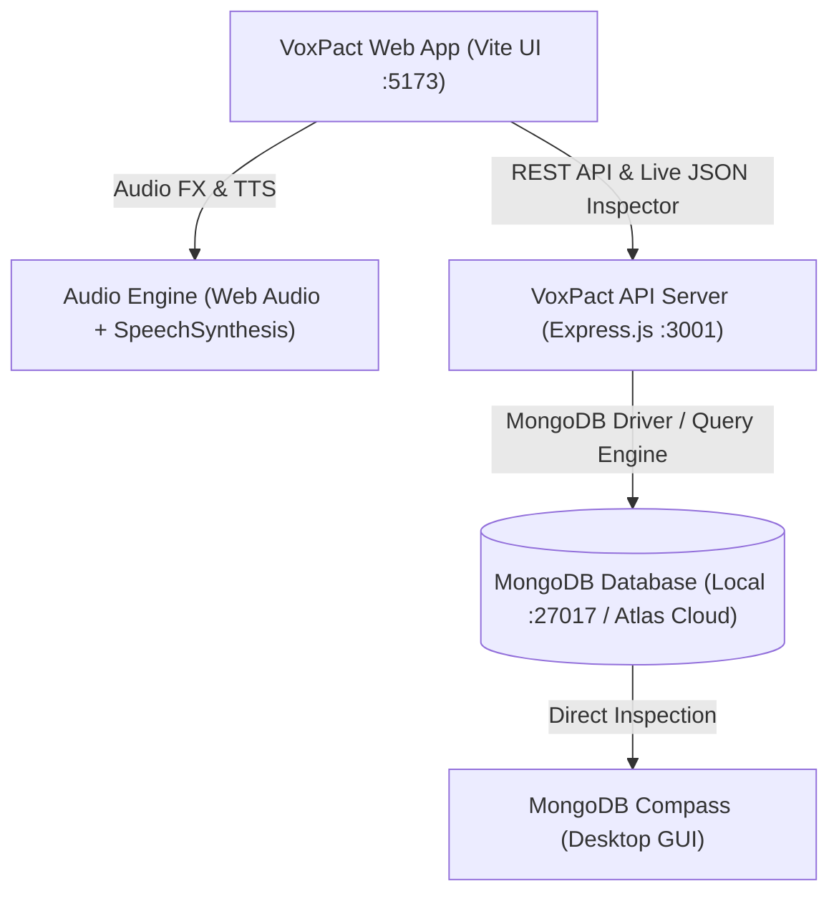

# 🎙️ VoxPact — Autonomous Voice AI Telephony & Deal Arbitration

> **Autonomous Voice AI Agent Swarm that places phone calls to businesses, conducts multi-turn verbal negotiations, audits hidden contract traps, logs cryptographically verifiable proof recordings, and synchronizes live deal data directly with MongoDB.**

[](https://www.mongodb.com/)
[](https://expressjs.com/)
[](https://vitejs.dev/)
[](https://developer.mozilla.org/en-US/docs/Web/JavaScript)
[](https://developer.mozilla.org/en-US/docs/Web/API/Web_Audio_API)

---

## 🌟 Key Features

- **🎙️ Real-Time Dual-Voice Telephony Synthesis**:
  - Web Audio API dual-channel voice simulation with telephony bandpass filtering and DTMF key tones.
  - Multi-turn voice dialogue where VoxPact counter-offers, uses aggressive anchoring, competitor pincers, and squeezes extra concessions before closing.
- **🍃 Live MongoDB & MongoDB Compass Integration**:
  - Connects directly to local MongoDB (`mongodb://localhost:27017/voxpact`) or **MongoDB Atlas Cloud**.
  - Built-in **MongoDB Live Document Inspector**: click any `🍃 .JSON` button to fetch live documents directly from MongoDB with query execution latency (ms) and BSON index lookups.
  - Pre-generated standalone JSON dumps in `./mongodb_dumps/` for instant drag-and-drop import into **MongoDB Compass**.
- **⚖️ Real-World P&L Analytics (Profit & Loss Scenarios)**:
  - Tracks **Gross Savings (+$342,800)**, **Deficits / Overruns (-$26,600)**, and **Net Realized P&L (+$316,200)**.
  - Realistic loss scenarios: flags salvage remediation fees (AutoMax Fleet) and spot scarcity surcharges (Titan Silicon) with automatic termination and rejection tags.
- **📜 Legal Proof-Vault & Audio Evidence Player**:
  - Interactive audio scrubber with verbal citation timestamps, acoustic stress analysis, and legal assent enforceability rating (99.4%).
  - SHA-256 tamper-proof call recording hashes.
- **📑 Binding Term Sheet & Seal**:
  - Digital contract seal with dual-party verbal assent stamps, exportable as legal audit trails (.TXT, .JSON, .WAV).

---

## 🏗️ System Architecture



---

## 🚀 Quick Start Guide

### 1. Prerequisites
- **Node.js** (v18.0.0 or later)
- **MongoDB** (Local `mongod` service on port 27017, or a free [MongoDB Atlas](https://www.mongodb.com/cloud/atlas) cluster)
- **MongoDB Compass** (Optional, for visual database inspection)

### 2. Installation & Setup

1. **Clone the repository**:
   ```bash
   git clone https://github.com/<your-username>/<your-repo-name>.git
   cd <your-repo-name>
   ```

2. **Install dependencies**:
   ```bash
   npm install
   ```

3. **Configure Environment Variables**:
   Copy `.env.example` to `.env`:
   ```bash
   cp .env.example .env
   ```
   *(By default, it connects to local `mongodb://localhost:27017/voxpact`)*.

4. **Seed the MongoDB Database**:
   ```bash
   npm run seed:mongo
   ```
   *This automatically seeds the 4 collections (`campaigns`, `vendors`, `call_records`, `evidence_vault`) into your MongoDB database and generates export dumps in `./mongodb_dumps`.*

---

## 🏃 Running the Application

In two separate terminal windows:

### Terminal 1: Backend API Server
```bash
node server/server.js
```
*Backend runs on `http://localhost:3001` with active MongoDB connection.*

### Terminal 2: Frontend Client (Vite)
```bash
npm run dev
```
*Frontend opens at `http://localhost:5173/`.*

---

## 🍃 MongoDB Compass Inspection

1. Launch **MongoDB Compass**.
2. Connect to:
   ```text
   mongodb://localhost:27017
   ```
3. Open database **`voxpact`**:
   - **`call_records`**: Review timestamped telephony transcripts and SHA-256 hashes.
   - **`vendors`**: Review profit and deficit/loss vendors (`v-automax`, `v-titan-spot`).
   - **`campaigns`**: Review procurement ceilings and constraints.
   - **`evidence_vault`**: Review verbal concessions and acoustic stress records.

*Alternatively, import any `.json` file from `./mongodb_dumps/` by clicking **"Add Data" -> "Import JSON"** in Compass.*

---

## 📂 Project Structure

```text
├── mongodb_dumps/          # Standalone MongoDB JSON dumps & full cluster dump
│   ├── campaigns.json
│   ├── vendors.json
│   ├── call_records.json
│   ├── evidence_vault.json
│   └── voxpact_full_cluster_dump.json
├── scripts/
│   └── seedMongo.js        # Automated MongoDB seeding & migration script
├── server/
│   └── server.js           # Express API server connecting directly to MongoDB
├── src/
│   ├── audioEngine.js      # Web Audio API telephony & voice synthesis engine
│   ├── mockData.js         # Procurement campaigns, vendor rosters & transcripts
│   ├── negotiationEngine.js# State machine for negotiation tactics & P&L stats
│   ├── style.css           # Premium dark-theme glassmorphism styles
│   └── main.js             # UI coordination, live MongoDB JSON viewer & audio HUD
├── index.html              # High-density mission control & vault interface
├── .env.example            # Environment variable template
├── package.json
└── README.md
```

---

## 📄 License

MIT License — Feel free to use and adapt for autonomous AI procurement research.
